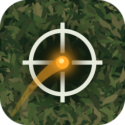

<p align="center"></p>

# GhillieClip

Finds every shot of your airsoft gun in a set of videos, tracks the BB in
flight, marks where it hits, and joins the moments into one highlight reel.
It learns what your gun sounds like and where its BB appears from your own
footage, so it works with any gun and camera mount, as long as the camera is
on the gun.

Requires `ffmpeg` and `ffprobe` on the `PATH`.

## Install

Download the archive for your platform from the
[latest release](https://github.com/bcluap/ghillieclip/releases/latest).
Each archive has a `.sha256` file alongside it for verification.

GhillieClip needs [FFmpeg](https://ffmpeg.org/) (`ffmpeg` and `ffprobe`) installed.

### Windows

1. Install FFmpeg: `winget install Gyan.FFmpeg`
2. Extract `ghillieclip-<version>-windows-x86_64.zip` and run `ghillieclip.exe`.

The executable is not code-signed, so SmartScreen may warn on first run:
choose **More info → Run anyway**.

### macOS

1. Install FFmpeg: `brew install ffmpeg`
2. Extract `ghillieclip-<version>-macos-arm64.zip` (Apple silicon) or
   `-macos-x86_64.zip` (Intel) and move `GhillieClip.app` to Applications.

The app is not notarised by Apple. Before the first launch, clear the
download quarantine flag:

```bash
xattr -dr com.apple.quarantine /Applications/GhillieClip.app
```

For the command line, the binary is `GhillieClip.app/Contents/MacOS/ghillieclip`.

### Linux (x86_64, glibc 2.35+)

1. Install FFmpeg: `sudo apt install ffmpeg` (or your distribution's equivalent)
2. Extract `ghillieclip-<version>-linux-x86_64.tar.gz` and run `./install.sh`
   to add `ghillieclip` to `~/.local/bin` with a desktop menu entry, or run
   `./ghillieclip` directly.

## Build from source

```bash
cargo build --release
```

## GUI

Run with no arguments:

```bash
./target/release/ghillieclip
```

1. **Add files…** / **Add folder…** to choose the footage, and **Save as…** for the output.
2. **Learn profile** (optional): learns your gun from the footage. **Save profile…** keeps it for next time.
3. **Analyse** lists the shots, BB tracks and impact distances without writing a video.
4. **Build highlight reel** writes the video.

Every setting has an ⓘ button: click it for a full explanation. Settings are remembered in
`~/.config/ghillieclip/settings.json` (`%APPDATA%\ghillieclip\settings.json` on Windows).

## Command line

```bash
# Learn from the footage, show markers and distances, keep 3 s before and 6 s after each shot
ghillieclip ~/Videos/Airsoft/20261010 -o highlights.mp4 \
  --pre 3 --post 6 --markers explosion --distance-at-impact --distance-live \
  --bb-mass 0.40 --muzzle-fps 450 --units m

# Learn once, save the profile, reuse it
ghillieclip ~/Videos/Airsoft/20261010 --learn-only --save-profile my_rifle.json
ghillieclip ~/Videos/Airsoft/20261011 --profile my_rifle.json -o day2.mp4

# Every setting via JSON (save from the GUI or with --save-settings)
ghillieclip --settings my_settings.json ~/Videos/Airsoft/20261012
```

`ghillieclip --help` lists every flag.

## How it works

- **Shots** are sharp sounds whose spectrum and decay match the profile's shot
  sound, loud enough to be your gun and not a bolt click (high-frequency share).
  The firing time is the start of the shot sound.
- **Learning** groups the loudest repeated sounds, rules out sounds that always
  follow another (bolt, cocking, echo), checks which group launches BBs from a
  consistent point in the view, and sets thresholds from that group.
- **BB tracking** corrects for recoil shake, finds the BB as a new bright dot
  leaving the launch point, then follows it with a curved prediction.
  **Follow sensitivity** trades losing the trail (low) against wandering onto
  clutter (high). Missing frames are filled in by interpolation.
- **Impacts** are where the BB vanishes while still bright, or where the scene
  around it suddenly changes.
- **Distance** uses a drag model for a sphere:
  `distance(t) = ln(1 + k·v0·t) / k`, with `k = ½ ρ Cd A / m`, from BB mass,
  muzzle velocity, diameter, drag coefficient and air density. `t` is the time
  from the start of the shot sound.

The bundled font is DejaVu Sans Bold (see `assets/DejaVu-LICENSE.txt`).

## Releasing

Bump `version` in `Cargo.toml`, then tag and push:

```bash
git tag v0.1.0 && git push origin v0.1.0
```

`.github/workflows/release.yml` builds Windows, macOS (arm64 and x86_64, as
`GhillieClip.app`) and Linux packages and attaches them to a GitHub release for the tag.

## Regression test pack

`testpack/` holds real clips (the videos are kept out of the repository;
only the case descriptions in `testpack/cases/` are published) with a reviewer's account of what happens in
them: when the shot is fired, until when the BB can be seen, when it hits,
where it is hidden, and positions where someone has confirmed by eye where
the BB is. Every change to detection or tracking should keep these passing.

```bash
# Run every case (exit code 1 if any check fails)
ghillieclip --test-pack testpack
# One case, or at another sensitivity
ghillieclip --test-pack testpack --test-filter hand --sensitivity 0.75

# Add a case (times in seconds of the source video; --trim cuts an excerpt
# and makes the times relative to it)
ghillieclip --add-test ~/Videos/clip.mp4 --pack testpack --id tree-line-miss \
  --shot 12.40 --visible-until 13.10 --impact 13.10 --occlusion 12.80-12.85 \
  --trim 10-16 --note "BB clips the tree line; reviewer sees it until 13.10 s"
```

Each case is a JSON file in `testpack/cases/` and can be edited by hand,
for example to add `checkpoints` (confirmed BB positions), more `shots`, set
`bb_not_visible` for a shot whose BB can't be seen, or `only_listed_shots: false`.

Checks per shot: detected within ±0.05 s; BB tracked; track ends within
±0.10 s of when the BB is last seen; impact within ±0.10 s; each checkpoint
within its pixel tolerance. Per case: no shots other than the listed ones.

## Artwork

The icon and splash screen are generated by `tools/make_art.py` (needs Pillow):

```bash
python3 tools/make_art.py
```

## Licence

MIT, see `LICENSE`. DejaVu Sans is under its own licence, see `assets/DejaVu-LICENSE.txt`.
